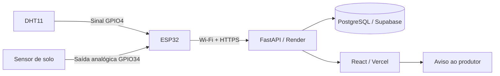

# Monitoramento ambiental com ESP32, histórico e aprendizado de máquina

**Instituição:** IFSULDEMINAS — Campus Machado
**Disciplina/professor:** Trabalho Prático: Agentes, IoT e Aprendizado de Máquina — Prof. Matheus Franco
**Autor/equipe:** preencher nomes e turma antes da entrega
**Data da revisão:** 10/11/2026

## 1. Problema e objetivo

Observar temperatura, umidade do ar e condição do solo; armazenar histórico;
visualizar variações e apoiar a decisão de verificar/irrigar a cultura. O sistema
não controla bomba ou relé. A ação do agente é um aviso digital ao produtor.

O monitoramento e os avisos por regra já são independentes do ML. Para a análise
preditiva, há três experimentos explicitamente separados: solo da placa (30 min),
temperatura da placa (5 min) e solo de estação pública externa (30 min).

## 2. Hardware e circuito

| Componente | Conexão identificada no firmware | Grandeza |
|---|---|---|
| ESP32 Dev Module | Wi-Fi e USB para programação/alimentação | Agente embarcado |
| DHT11 | Sinal no GPIO4 | Temperatura (°C) e umidade relativa (%) |
| Sensor de solo | Saída analógica no GPIO34 | Valor ADC bruto |
| Aviso digital | Dashboard/navegador | Ação ao produtor |

A alimentação, versão exata do módulo de solo, resistores e fotografia do circuito
montado devem ser anexados pela equipe. O software não comprova essas ligações
físicas. Documentar as tensões utilizadas e verificar compatibilidade dos sinais
com a ESP32; não supor tolerância de entrada a 5 V.

## 3. Arquitetura e funcionamento

1. O WiFiManager tenta a rede salva; quando necessário abre um portal local para
   selecionar outra rede. Nome/senha do Wi-Fi não ficam no repositório.
2. A ESP32 lê os sensores a cada 3 s e mantém um painel HTML local.
3. Sincroniza o horário UTC por NTP. Sem relógio válido ou com DHT inválido, não
   envia uma amostra inventada.
4. A cada aproximadamente 30 s, envia JSON por HTTPS para a Render com X-API-Key,
   validando o certificado pelo bundle do core ESP32 3.3.12.
5. O FastAPI valida o contrato, grava a amostra e retorna HTTP 201.
6. O PostgreSQL preserva `measured_at` e `received_at`. RLS está ativo; acesso às
   tabelas pelo proprietário do backend é separado dos papéis públicos.
7. O React consulta a API a cada 30 s com a página visível e mostra cartões,
   gráficos, filtros, CSV, estado, condição por regra e resultados de modelos.
8. O backend verifica treino a cada 5 min enquanto está ativo. Os modelos ficam
   versionados no banco; o retreino exige intervalo de 1 h e 120 novas amostras.

O envio direto HTTP 201 foi demonstrado pelo usuário no Monitor Serial em
10/11/2026 às 10:43:45 UTC (07:43:45 em Brasília). Isso comprova um envio, não uma
medida de disponibilidade contínua. A rede do campus bloqueou acesso local ao IP,
mas o envio HTTPS de saída funcionou; o coletor Python deixou de ser necessário.

## 4. Definição PEAS

| Elemento | Definição |
|---|---|
| Medida de desempenho | Persistência das amostras, atualização do painel, MAE/RMSE versus persistência, avisos corretos e distinção de falhas |
| Ambiente | Condições ambientais, solo monitorado, rede local e serviços de nuvem |
| Atuadores/ações | Avisos visuais e notificações do navegador; decisão física permanece com o produtor |
| Sensores/percepções | Temperatura, umidade do ar, leitura bruta do solo e horário/última comunicação |

## 5. Registro de percepções, decisões e ações

| Percepção/condição | Decisão | Ação/aviso/previsão |
|---|---|---|
| Amostra válida e recente | Incorporar ao histórico | Atualizar cartão, gráfico e inferência quando disponível |
| DHT11 inválido | Descartar amostra | Mensagem no Serial; não inserir valor fictício |
| Sem amostra há mais de 5 min | Condição desatualizada | Aviso de atraso; suspender notificação preditiva |
| Solo estimado abaixo de 30% | Aplicar regra de referência | Orientar verificação de irrigação; marcar como regra, não ML |
| Modelo prevê solo abaixo do limite | Avaliar risco futuro | Aviso preditivo se modelo da placa superar o baseline |
| Modelo externo | Manter separado | Exibir experimento histórico sem recomendar irrigação da ESP32 |
| Temperatura prevista pelo modelo real | Exibir inferência experimental | Mostrar horizonte de 5 min, versão e erros em °C |
| Modelo sem melhoria de MAE | Não tratar como confiável | Identificar resultado como experimental e evitar alerta automático |

Os avisos do navegador exigem permissão e página aberta. A entrega de avisos não
é persistida ou confirmada pelo SO. Não há WhatsApp, e-mail ou irrigação automática.

## 6. Dados e preparação

O dicionário está em `docs/dicionario-dados.md`. A base real usada no primeiro
experimento de temperatura foi exportada em `ml/data/esp32-temperature-training.csv`:
489 linhas, IDs até 489. SHA-256:
`b5381e427aba5fd5583fde3e1240524f83e0499ab8c731146fe4e26510c64bb9`.

A base fica fora do Git e deve ser anexada à entrega separadamente. Não contém
senhas nem chaves. O relatório do experimento está em
`ml/reports/esp32-temperature.json`, incluindo hash do dataset preparado.

Amostras são agregadas por média em minutos completos UTC. O modelo de solo exige
continuidade de todos os minutos da janela de atributos e horizonte. O experimento
de temperatura aceita no máximo um minuto ausente entre pontos observados e exige
os valores exatos no instante atual, cinco minutos anteriores e cinco futuros.
Não há interpolação ou fabricação de valores faltantes.

## 7. Modelos e avaliação

Algoritmo: **RandomForestRegressor**, 100 árvores, profundidade máxima 8,
`min_samples_leaf=3`, `random_state=42`, `n_jobs=1`. Parâmetros fixos, sem escolher a
melhor configuração usando o teste. Árvores numéricas persistidas em JSON, sem
pickle executável. O mesmo modelo avaliado é salvo; não é reajustado com o teste.

### Temperatura da própria placa

- Alvo: temperatura média de um minuto completo, cinco minutos à frente.
- Atributos: temperatura e umidade do ar atuais, ambas cinco minutos antes e
  variação da temperatura em cinco minutos. Solo não é atributo desse experimento.
- Justificativa: há variação observada no DHT11 e histórico mais curto/fragmentado;
  o horizonte de 5 min é um experimento preliminar distinto do solo em 30 min.
- Separação cronológica de 75%/25%, com purga para impedir sobreposição do alvo de
  treino com a janela de atributos do teste.
- Treino: 51 exemplos; teste: 20; purgados: 8. Amostra pequena: resultado preliminar.
- Treino, instantes-base: a partir de 10/11/2026 00:52 UTC. Último alvo de treino:
  10:00 UTC. Teste, instantes-base a partir de 10:57 UTC; último alvo: 11:21 UTC.

| Método | MAE (°C) | RMSE (°C) |
|---|---:|---:|
| Random Forest | 6,106278 | 6,573169 |
| Persistência: manter temperatura atual | **1,777500** | **2,199631** |

**O modelo não superou o baseline.** O experimento comprova treino, avaliação e
inferência com dados reais, mas não eficácia preditiva. O histórico tem lacunas,
poucos exemplos e mudanças de condições; possível mudança de distribuição merece
investigação, não deve ser tratada como causa comprovada. Coletar novos períodos
independentes e vários ciclos antes de avaliar utilidade operacional.

### Solo da placa e experimento externo

A previsão nativa do solo continua com horizonte de 30 min. Na auditoria, havia
118 minutos completos e zero janelas pela exigência estrita de continuidade; o
registro de novos pontos durante o desenvolvimento pode mudar esses números.
Sem exemplos suficientes não é gerado modelo nativo de solo fictício.

O experimento público de Kompoti tem 7.480 exemplos de treino e 2.496 de teste:
MAE 0,107816 pp (modelo) versus 0,019832 pp (persistência). Também não superou a
referência. Fonte, licença CC BY 4.0, limpeza, limitações e reprodução estão em
`ml/EXTERNAL_DATASET.md`. Esse percentual não equivale ao ADC da ESP32.

Não usar a temperatura prevista ou o modelo externo como substituto indevido de
uma validação de irrigação no solo local.

### Exemplo de inferência real registrado

Em 10/11/2026 às 11:28:03 UTC, o modelo salvo recebeu as leituras recentes reais:
base 11:28 UTC, temperatura atual 26,60 °C, previsão 23,48 °C para 11:33 UTC.
O registro está em `ml/reports/esp32-temperature-prediction.json`, identificado como
experimental. Trata-se de previsão, não de confirmação do valor observado no alvo.
O hash do snapshot do treino foi reproduzido a partir do CSV exportado; o manifesto
está em `ml/reports/esp32-dataset-manifest.json`.

## 8. Validação e demonstração

A verificação automatizada cobre validação HTTP, autenticação, filtros, CSV de
origem, separação temporal, persistência de modelos, baseline, árvore JSON,
independência de alvos, avisos e falhas. Casos de navegador usam respostas
controladas e notificações simuladas, sem apresentá-las como evidência de campo.

O roteiro `docs/apresentacao.md` orienta a demonstração real: amostra → HTTP 201 →
banco → dashboard → previsão experimental e aviso por regra, incluindo ausência
de comunicação. Concluir o teste no site após publicar as alterações atuais.

## 9. Limitações e melhorias

- Melhorar o ML exige novos dados, avaliação em outros blocos temporais e manejo
  representativo; não pode ser resolvido inventando oscilações no software.
- Calibração 4095/2901 e limites de 30% solo/40% ar são referências configuráveis,
  não parâmetros agronômicos universais ou medida volumétrica certificada.
- Render Free pode suspender a API e o treino por inatividade; não há garantia de
  operação contínua nessa configuração.
- Não há fila persistente na placa ou deduplicação de POST; a próxima tentativa usa
  outra amostra. Notificações não funcionam com a página/navegador fechados.
- Chave compartilhada de operador/dispositivo deve evoluir para autenticação e
  permissões separadas. Não publicar `.env`, `secrets.h` ou binários com a chave.
- Acrescentar fotografia do circuito, nomes/turma e evidências finais de campo.

## 10. Referências

- Enunciado do trabalho fornecido pelo usuário, Prof. Matheus Franco.
- https://scikit-learn.org/stable/modules/generated/sklearn.ensemble.RandomForestRegressor.html
- https://scikit-learn.org/stable/common_pitfalls.html
- https://zenodo.org/records/21703750
- https://github.com/tzapu/WiFiManager
- https://github.com/espressif/arduino-esp32/tree/master/libraries/NetworkClientSecure
